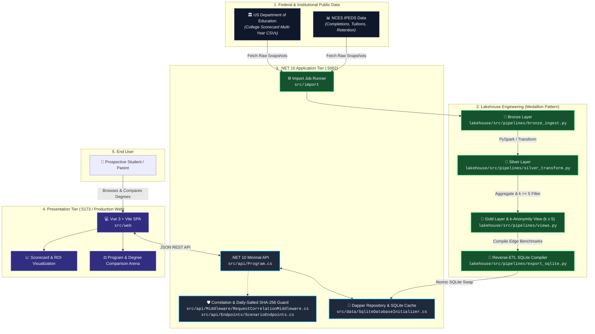
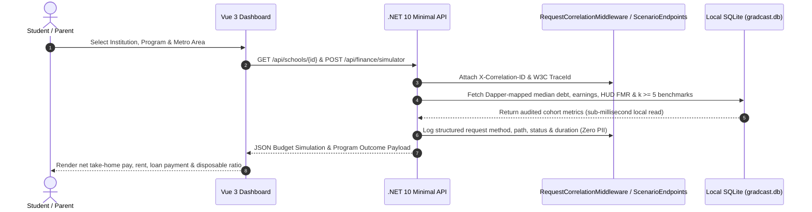

<!-- diagram-meta
  last-validated: 2026-10-27
  validated-commit: 282c416
  covers: [src/**, lakehouse/**]
  generated-by: manual
-->

# Architecture & Invariants Specification: GradCast Transparency Engine

> Full-stack higher education return-on-investment (ROI), outcome transparency platform, and public data lakehouse.

---

## 1. Executive Summary

`gradcast` is a public-data reality engine in the `knowthankyew` portfolio built to eliminate the information asymmetry between prospective college students and higher education marketing claims. Leveraging multi-year federal datasets (U.S. Department of Education College Scorecard, IPEDS, and Treasury earnings data), it pairs a Medallion lakehouse pipeline with a high-performance .NET 10 Minimal API and a Vue 3 interactive dashboard—processing personal simulation inputs transiently without server persistence, keeping personal saved scenarios in browser `localStorage`, and persisting only voluntarily shared, anonymized scenarios (never raw IP addresses) under hard $k \ge 5$ cohort suppression.

---

## 2. System Architecture & Data Flow

### A. System Architecture & Lakehouse Pipeline



### B. Query & Transparency Lifecycle



---

## 3. Core Architectural Invariants

| # | Invariant | Enforcement & Guarantee |
|:--|:----------|:------------------------|
| 1 | **No Raw PII Persistence & Hard k-Anonymity (`k >= 5`)** | Personal simulation inputs are processed transiently without server persistence and personal saved scenarios remain in browser `localStorage`; when scenarios are voluntarily shared, raw IP addresses are never persisted—only a daily-rotating salted `SHA256` digest is stored at the edge for rate limiting, removed prior to `silver.scenarios` conformance, and `HAVING COUNT(*) >= 5` suppresses small cohorts in `v_public_positive_finds`. |
| 2 | **Dual-Mode Edge Read Isolation** | All production web reads are served from local SQLite (`gradcast.db`) via Dapper; direct Databricks cluster queries during live web traffic are prohibited. |
| 3 | **Central Package Management (CPM)** | 100% of .NET dependencies are pinned via root `Directory.Packages.props` with zero inline `.csproj` version overrides. |
| 4 | **Universal Multi-Stage Containerization** | Docker multi-stage Alpine build (`Dockerfile`) separating Node 22 Vite asset compilation and .NET 10 ASP.NET Core runtime executing under non-root `USER $APP_UID`. |
| 5 | **Fail-Closed Dependency Auditing** | MSBuild `NuGetAudit` enabled at build time (`Directory.Build.props`) with `NU1903`/`NU1904` treated as build errors. |

---

## 4. Directory Structure

```
gradcast/
├── Directory.Build.props        # NuGetAudit & fail-closed security properties
├── Directory.Packages.props     # Central Package Management (CPM) versions
├── GradCast.slnx                # Visual Studio solution file
├── Dockerfile                   # Multi-stage production container build
├── scripts/
│   └── audit-claims.py          # Portfolio-standard claims & invariant linter entrypoint
├── lakehouse/                   # Medallion lakehouse ETL pipelines
│   ├── src/                     # PySpark transformations (Bronze, Silver, Gold, Views, Reverse-ETL)
│   ├── terraform/               # Unity Catalog & RBAC infrastructure definitions
│   ├── scripts/                 # Lakehouse claims, DDL parity & privacy invariant implementation
│   └── tests/                   # Data quality, schema & claims validation suites
├── src/
│   ├── api/                     # .NET 10 Minimal API (Endpoints, Middleware)
│   ├── api.tests/               # xUnit integration & endpoint test suite
│   ├── data/                    # Dapper SQLite repository, schema DDL & reference seeders
│   ├── import/                  # Federal data ingestion utilities
│   └── web/                     # Vue 3 + Vite frontend application
└── docs/
    ├── ARCHITECTURE.md          # Architecture, data flow & invariant specification
    ├── PRIVACY_TELEMETRY_SCHEMA.md # Telemetry contract specification
    ├── QA_CHECKLIST.md          # Manual & automated QA verification runbook
    └── SCHEMA.md                # Unity Catalog & SQLite schema DDL specification
```
