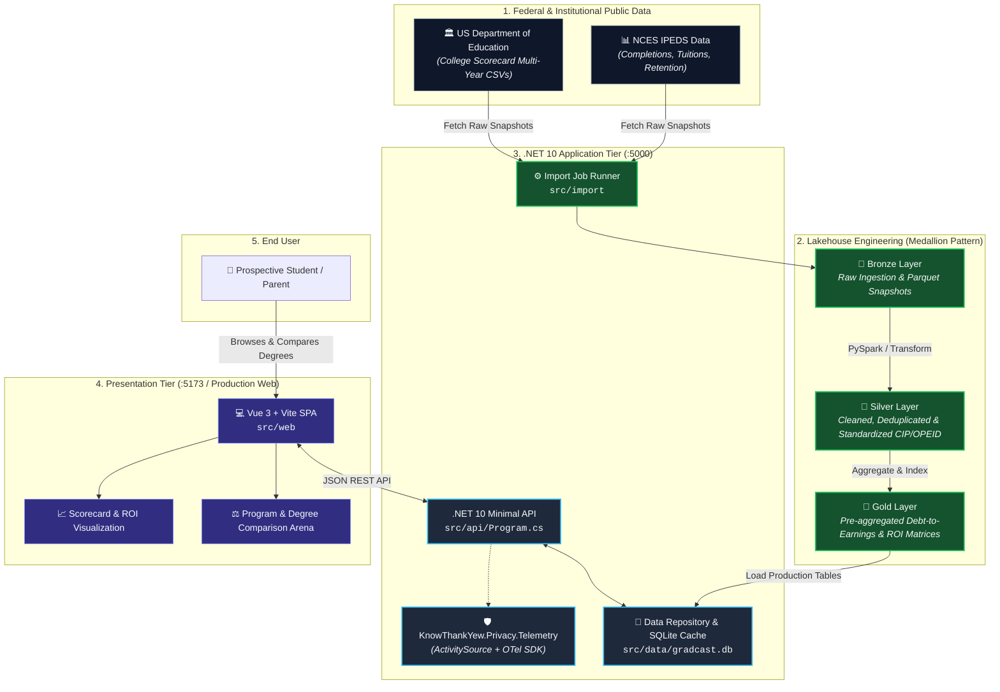
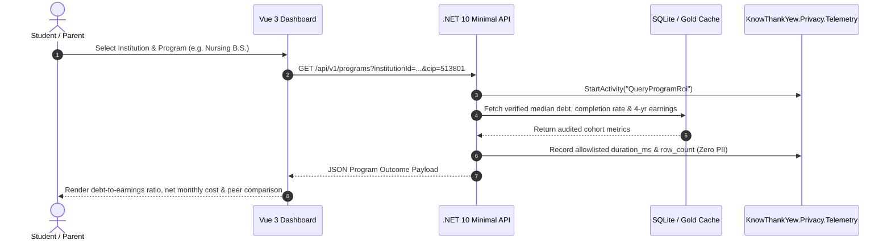

<!-- diagram-meta
  last-validated: 2026-10-19
  covers: [src/**, lakehouse/**]
  generated-by: manual
-->

# Architecture & Invariants Specification: GradCast Transparency Engine

> Full-stack higher education return-on-investment (ROI), outcome transparency platform, and public data lakehouse.

---

## 1. Executive Summary

`gradcast` is a public-data reality engine in the `knowthankyew` portfolio built to eliminate the information asymmetry between prospective college students and higher education marketing claims. Leveraging multi-year federal datasets (U.S. Department of Education College Scorecard, IPEDS, and Treasury earnings data), it pairs a Medallion lakehouse pipeline with a high-performance .NET 10 Minimal API and a Vue 3 interactive dashboard, delivering honest program-level debt-to-earnings comparisons with zero consumer data collection.

---

## 2. System Architecture & Data Flow

### A. System Architecture & Lakehouse Pipeline



### B. Query & Transparency Lifecycle



---

## 3. Core Architectural Invariants

| # | Invariant | Enforcement & Guarantee |
|:--|:----------|:------------------------|
| 1 | **Zero Consumer PII Collection** | Queries are anonymous; no accounts, session tracking, credit card data, or student identifiers are ingested. |
| 2 | **Public Data Integrity** | Every institution statistic is traced directly to federal OPEID / IPEDS UNITID source records. |
| 3 | **Central Package Management (CPM)** | 100% of .NET dependencies are pinned via root `Directory.Packages.props` with fail-closed vulnerability gating. |
| 4 | **Universal Multi-Stage Containerization** | Docker multi-stage Alpine build separating Node Vite assets and .NET 10 AOT runtime for minimal attack surface. |
| 5 | **Fail-Closed Dependency Auditing** | MSBuild `NuGetAudit` enabled at build time with `NU1903`/`NU1904` treated as build errors. |

---

## 4. Directory Structure

```
gradcast/
├── Directory.Build.props        # NuGetAudit & fail-closed security properties
├── Directory.Packages.props     # Central Package Management (CPM) versions
├── GradCast.slnx                # Visual Studio solution file
├── Dockerfile                   # Multi-stage production container build
├── lakehouse/                   # Medallion lakehouse ETL pipelines
│   ├── src/                     # PySpark transformations (Bronze, Silver, Gold)
│   ├── terraform/               # Cloud infrastructure definitions
│   └── tests/                   # Data quality & schema validation suites
├── src/
│   ├── api/                     # .NET 10 Minimal API (Endpoints, Middleware)
│   ├── api.tests/               # xUnit integration & endpoint test suite
│   ├── data/                    # EF Core SQLite repository & migrations
│   ├── import/                  # Federal data ingestion utilities
│   └── web/                     # Vue 3 + Vite frontend application
└── docs/
    ├── ARCHITECTURE.md          # Architecture, data flow & invariant specification
    ├── PRIVACY_TELEMETRY_SCHEMA.md # Telemetry contract specification
    └── SCHEMA.md                # Federal dataset schema mapping guide
```
